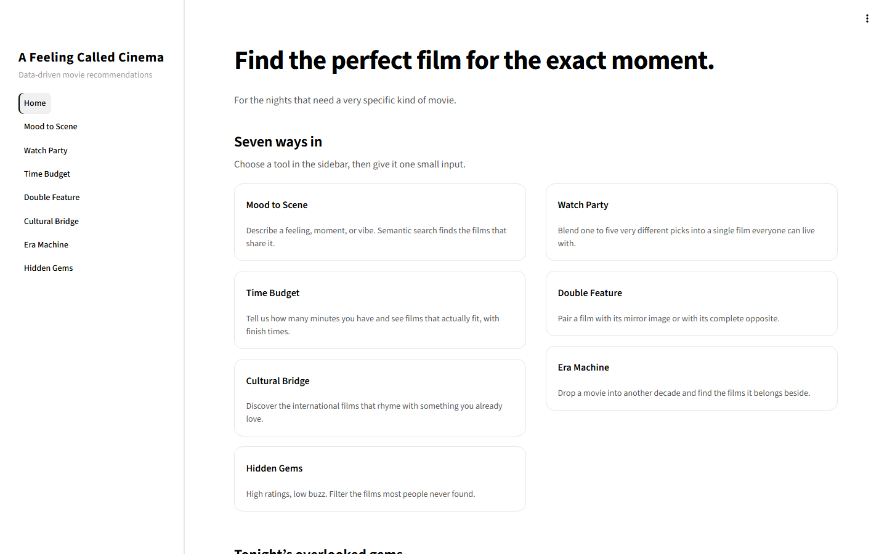
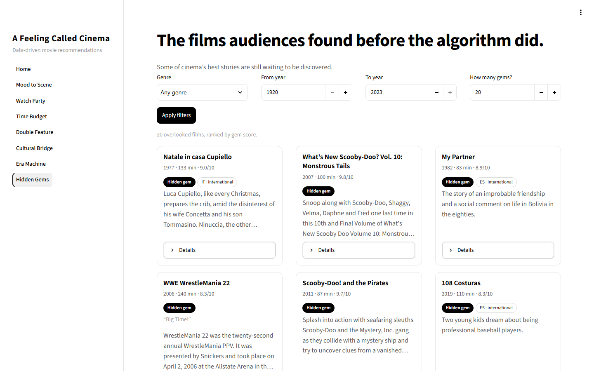

# A Feeling Called Cinema

A content-based film recommender built on 25,706 movies and 384-dimensional
semantic embeddings. Instead of scrolling through genres, you describe the
feeling, the time you have, the group you are watching with, or the film you
already love — and the engine finds what fits.

The project ships with a **Streamlit app** and an optional **React client
backed by FastAPI**. Both expose the same seven recommendation tools.

## Table of Contents

- [Project Overview](#project-overview)
- [The Problem](#the-problem)
- [Features](#features)
- [Technologies Used](#technologies-used)
- [Project Structure](#project-structure)
- [Installation](#installation)
- [Running the App](#running-the-app)
- [Usage Guide](#usage-guide)
- [Screenshots](#screenshots)
- [Contributing](#contributing)
- [Support](#support)

## Project Overview

Streaming catalogues are enormous, but their filters are not. You can pick a
genre and a decade, yet not "something tense but warm, under two hours, that my
whole group will tolerate."

A Feeling Called Cinema treats a movie as a 384-dimensional vector built from
its plot summary, tagline, genres, tone, and production metadata. Recommendations
are produced with cosine similarity over those vectors, combined with practical
constraints such as runtime, language, decade, and group agreement.

Two signals keep the results grounded:

- **Weighted rating** balances a film's average score against how many people
  rated it, so a 9.0 from 50 voters does not outrank an 8.4 from 20,000.
- **Gem score** rewards strong ratings with low popularity, surfacing films most
  people never found.

No external recommendation API is called at runtime. The dataset, embeddings,
and ranking logic all live in this repository.

## The Problem

| Everyday problem | What this project does |
| --- | --- |
| Endless scrolling and decision fatigue | Returns a short, ranked list for a specific intent |
| Genre filters are too coarse | Understands free-text mood and tone through embeddings |
| Groups cannot agree | Blends up to five favourites into one shared vector |
| "We only have 95 minutes" | Filters by runtime and shows the exact finish time |
| Watchlists are US-centric | Surfaces international films with the same fingerprint |
| Nostalgia without repetition | Finds a film's closest companion from another decade |
| Great films stay invisible | Ranks overlooked, high-rated films by gem score |

## Features

| Tool | What it does | How it works |
| --- | --- | --- |
| **Mood to Scene** | Turns a feeling into a ranked film list | Encodes the query with MiniLM and ranks movies by embedding similarity |
| **Watch Party** | Finds one film a group can agree on | Averages the picks into a centroid, excludes the picks, relaxes filters only when needed |
| **Time Budget & Bedtime** | Fits a film into the minutes you have | Runtime filter, weighted-rating order, optional calm-only mode, and finish clocks |
| **Double Feature** | Pairs a film with its mirror or opposite | Mirror: high similarity from a different decade. Contrast: shared genre with an intensity shift |
| **Cultural Bridge** | Finds international counterparts | Similarity search restricted to non-domestic films, with language badges |
| **Era Machine** | Moves a film into another decade | Similarity search restricted to the chosen decade |
| **Hidden Gems** | Finds high-rated, low-buzz films | Filters hidden gems by genre and year, then ranks by gem score |

## Technologies Used

- **Recommendation engine:** Python, pandas, NumPy, and
  `sentence-transformers/all-MiniLM-L6-v2`
- **Streamlit app:** Streamlit with a custom black-and-white theme
- **Optional web client:** FastAPI, Uvicorn, React 19, and Vite

## Project Structure

```text
.
├── app.py                      # Streamlit application
├── backend/                    # FastAPI routes and schemas
├── src/recommender.py          # Recommendation engine (all seven tools)
├── data/processed/             # Dataset, embeddings, and embedding ids
├── frontend/                   # React client
├── docs/screenshots/           # README screenshots
├── .streamlit/config.toml      # Streamlit theme
└── requirements.txt
```

## Installation

You need **Python 3.10 or newer**. Node.js 18+ is only needed if you want to run
the optional React client.

1. **Clone the repository**

   ```bash
   git clone https://github.com/MoazzamFarooqui/A-Feeling-Called-Cinema.git
   cd A-Feeling-Called-Cinema
   ```

2. **Install the Python dependencies**

   ```bash
   pip install -r requirements.txt
   ```

   If `pip` reports an "externally managed environment" error, create a virtual
   environment first:

   ```bash
   python -m venv venv
   venv\Scripts\activate      # Windows
   source venv/bin/activate   # macOS / Linux
   ```

3. **That's it.** The processed dataset and embeddings are already included, so
   there is no data prep step.

## Running the App

Start the Streamlit app:

```bash
streamlit run app.py
```

Open [http://localhost:8501](http://localhost:8501). The sidebar lists the seven
tools; the landing page shows an overview and live hidden gems. An internet
connection is needed only on the first mood search, when the MiniLM model is
downloaded once and cached.

### Optional: FastAPI + React client

Terminal 1 — start the API:

```bash
uvicorn backend.main:app --reload --port 8000
```

Interactive API documentation is available at
[http://localhost:8000/docs](http://localhost:8000/docs).

Terminal 2 — install and start the React client:

```bash
cd frontend
npm install
npm run dev
```

Open [http://localhost:5173](http://localhost:5173). The client calls
`http://127.0.0.1:8000` by default; set `VITE_API_URL` to override it.

## Usage Guide

1. **Mood to Scene** — Describe a feeling, not a genre, e.g. "a quiet film about
   grief by the sea". Choose how many results you want, then search.
2. **Watch Party** — Pick one to five films your group loves, optionally set a
   maximum runtime and shared genre, then find the film everyone can agree on.
3. **Time Budget & Bedtime** — Enter the minutes available and your start time.
   Enable calm-only if it is close to bedtime. Every card shows when the film ends.
4. **Double Feature** — Choose a film and a mode: **mirror** finds a kindred film
   from another decade, while **contrast** finds a shared genre with the opposite
   intensity.
5. **Cultural Bridge** — Choose a film to see international films that share its
   emotional and narrative fingerprint, with language badges.
6. **Era Machine** — Choose a film and a decade to find its closest contemporaries
   from that era.
7. **Hidden Gems** — Filter by genre and year range, then browse films ranked by
   gem score: strong ratings, low popularity.

## Screenshots

**Home — seven ways in**



**Hidden Gems — filtered and ranked by gem score**



## Contributing

1. Fork the repository and create a feature branch:
   `git checkout -b feat/your-feature`.
2. Make your changes and check the app locally.
3. Open a pull request describing the problem and the change.

## Support

- Open an issue for bugs, ideas, or questions:
  [GitHub Issues](https://github.com/MoazzamFarooqui/A-Feeling-Called-Cinema/issues)
- While the backend is running, use the generated API documentation:
  [http://localhost:8000/docs](http://localhost:8000/docs)
